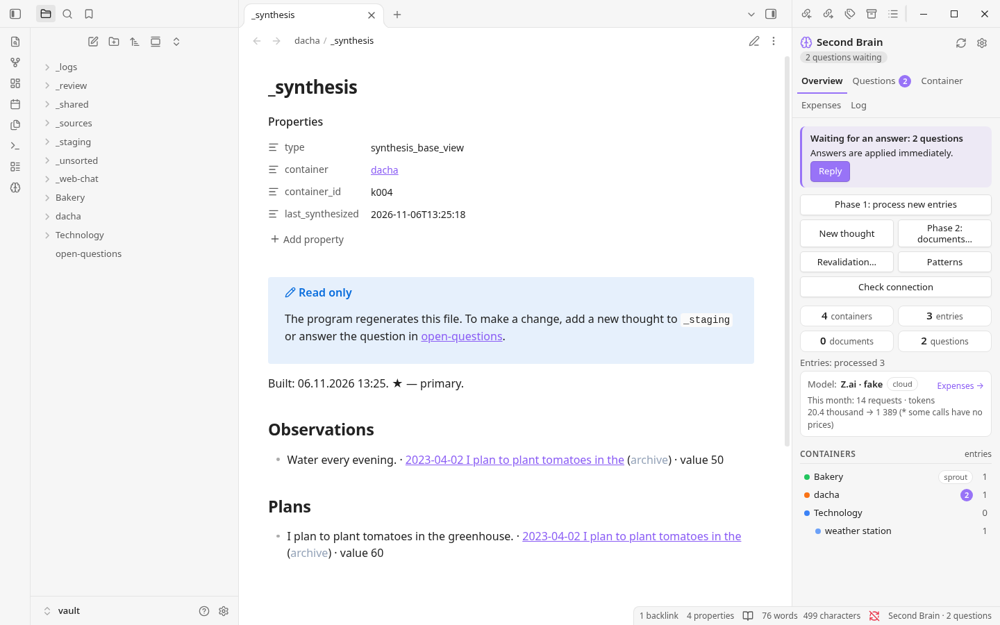
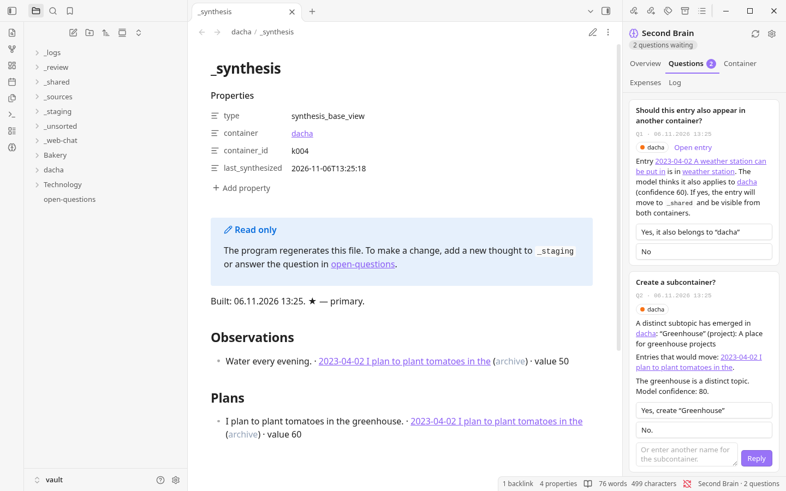

# Second Brain

**From scattered notes to a connected picture of your projects.**

Second Brain is an Obsidian companion that helps you make sense of thoughts collected over time. Give it notes, diary entries or AI conversations; it helps organize them by project, finds meaningful connections and turns the material into useful documents—without replacing your original writing.

[English](README.md) · [Русский](README.ru.md) · [Español](README.es.md) · [Українська](README.uk.md)

---

## Your ideas deserve more than a folder

A thought rarely arrives in the right place, in a finished form, or at the right time. Over months and years, ideas, decisions and open questions end up scattered across files. Finding them again is hard; understanding how they relate is harder still.

Second Brain is designed for that messy middle. You can write first and organize later. It brings related material together, points out uncertainty and helps build an up-to-date view of each project. You stay involved in the decisions that matter.

## See it in action


*The overview alongside a project's synthesis base.*


*When a decision needs your attention, it appears in Questions.*

Screenshots use a demonstration vault and a simulated model, not personal notes or a live AI service.

## How it works

```text
Notes, journals and conversations
              ↓
       _staging / import
              ↓
  Phase 1 · organize and analyze
              ↓
  Projects → aspects → synthesis base
              ↓
    Phase 2 · write documents
```

1. **Collect.** Add `.txt` or `.md` files to `_staging`, or use **New thought** in the panel. On a first bulk import, review and approve the proposed project structure.
2. **Understand.** Phase 1 places entries, extracts aspects such as facts, ideas and plans, and looks for duplicates, changes and contradictions. It builds a synthesis base for each affected project.
3. **Decide.** The model proposes and scores; the program applies configurable thresholds. Some uncertain or consequential cases become questions for you to resolve. For an unresolved contradiction, the system may use a marked provisional assumption until you answer.
4. **Write.** Run Phase 2 for a project. The model uses its synthesis base to create a required **Summary** and, where useful, additional documents suited to the material. You can edit the results; the program takes those edits into account in later runs.

## Why Second Brain?

- **Your original material stays yours.** Source files are preserved unchanged; outdated or duplicate material is marked rather than silently discarded. Previous document versions are retained.
- **Not just a search result.** The synthesis base brings together the pieces that matter for a project, including unresolved contradictions and alternative paths.
- **A person stays in the loop.** Review proposed structures, answer questions and adjust thresholds rather than letting the model make every decision alone.
- **Choose how to use AI.** Use an OpenAI-compatible cloud API, your own compatible model server, or a manual web-chat workflow. You can choose different profiles for different steps.
- **Files you can inspect.** Notes and documents are stored in your Obsidian vault as Markdown; working data is kept in local files. No database server is required.
- **Work on your terms.** Processing starts when you request it, can resume after interruption, and offers cost estimates and budget controls for cloud use.

## Getting started

The bundled installer is for **Windows**. You need **Obsidian**, internet access for installation, and **Python 3.10+**; the installer can offer to install Python if it is missing. The default local embedding model is about **6.9 GB** and requires at least **16 GB RAM for CPU use**. A GPU is optional; an external or cloud embedding service is an alternative.

1. Create or open an Obsidian vault. Choose the **English distribution** and extract it to a separate program folder **outside** the vault.
2. Run `Install.bat`, choose the vault and follow the prompts. Enable community plugins only if you trust their source.
3. In **Settings → Second Brain → Models**, configure a language model and an embedding model, then use **Check connection**.
4. Put a few `.txt` or `.md` files in `_staging`. Run **Phase 1**, review the proposed structure if prompted, and answer any questions.
5. Select a project and run **Phase 2** to write its documents.

For installation and everyday use, see `INSTRUCTION.md` in the English distribution. Start with a test vault or a copy of your notes and keep backups. Do not overwrite an existing installation with a different language edition; migration between editions has not been verified.

## Privacy & model choices

By default, embeddings run locally. You may configure an external embedding service instead. If you choose a cloud language model or cloud embeddings, the relevant text is sent to that provider; review its terms and privacy policy. API keys are stored beside the program rather than in the vault. Manual web chat still requires embeddings, which can be local or external.

Model output is not guaranteed to be correct. Review generated documents, especially contradictions and important decisions. The English edition prompts models to follow the language of the source notes, but actual behavior depends on the model.

## Documentation

The Python engine handles processing and model calls; the Obsidian plugin provides the interface. The [technical specification](SPECIFICATION.en.md) explains the pipeline, formats, prompts and design decisions in detail. The user guide in each distribution covers setup and day-to-day use.

---

*Built for ideas that are worth returning to.*
