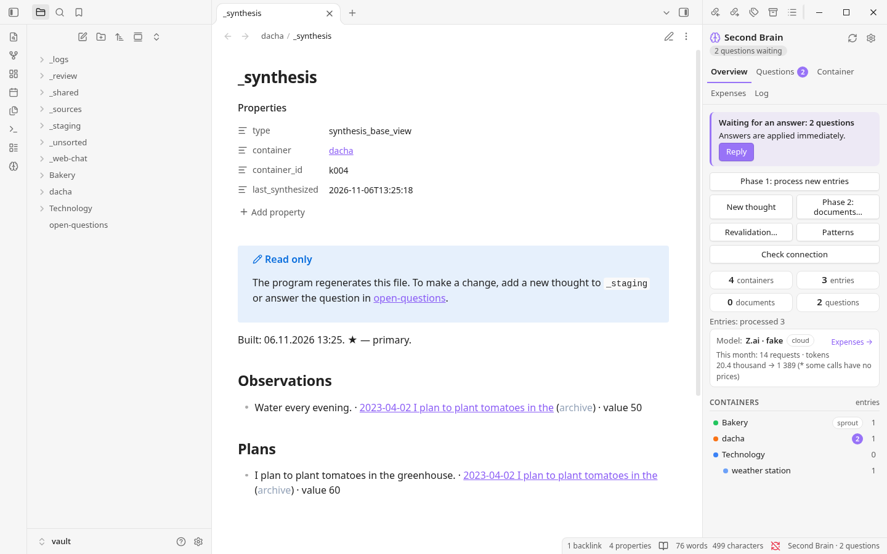
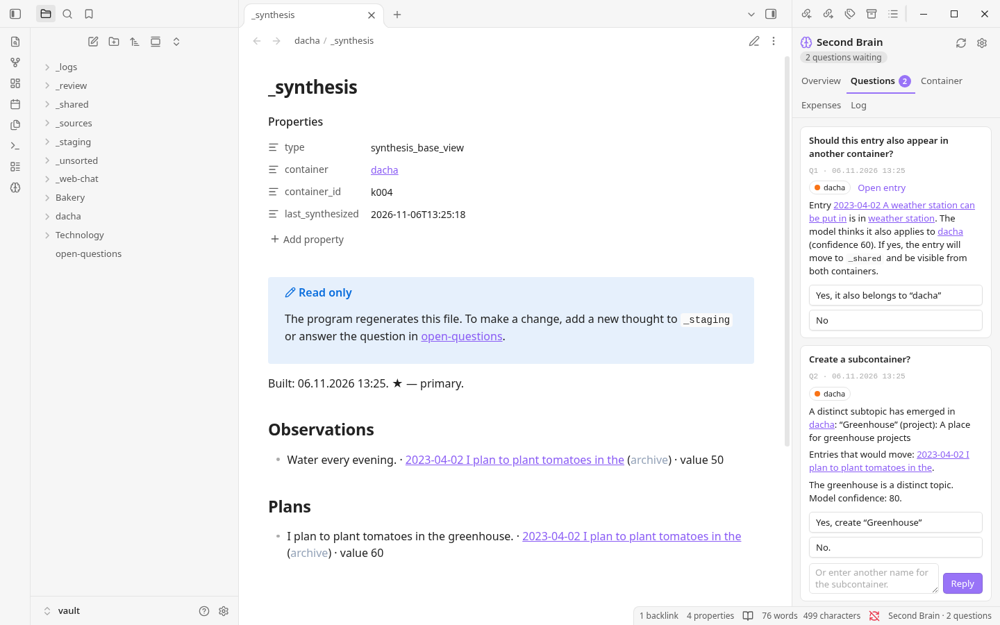

# Second Brain

**De notas dispersas a una visión conectada de tus proyectos.**

Second Brain es un complemento para Obsidian que te ayuda a comprender las ideas que acumulas con el tiempo. Añade notas, diarios o conversaciones con IA: el programa ayuda a organizarlos por proyecto, descubre conexiones y crea documentos útiles sin sustituir tus textos originales.

[English](README.md) · [Русский](README.ru.md) · [Español](README.es.md) · [Українська](README.uk.md)

---

## Tus ideas merecen algo más que una carpeta

Una idea rara vez llega al lugar adecuado, en su forma definitiva y en el momento oportuno. Con los meses y los años, las ideas, decisiones y preguntas pendientes quedan repartidas entre archivos. Volver a encontrarlas es difícil; entender cómo se relacionan lo es aún más.

Second Brain está pensado para ese desorden. Puedes escribir primero y organizar después. El programa reúne el material relacionado, señala las dudas y ayuda a construir una visión actualizada de cada proyecto. Tú sigues participando en las decisiones importantes.

## Así se ve


*La vista general junto a la base de síntesis de un proyecto. La interfaz mostrada está en inglés.*


*Cuando una decisión requiere tu atención, aparece en Questions.*

Las capturas muestran una bóveda de demostración y un modelo simulado, no notas personales ni un servicio de IA real.

## Cómo funciona

```text
Notas, diarios y conversaciones
              ↓
       _staging / importación
              ↓
  Fase 1 · organizar y analizar
              ↓
  Proyectos → aspectos → base de síntesis
              ↓
     Fase 2 · crear documentos
```

1. **Reúne.** Añade archivos `.txt` o `.md` a `_staging`, o usa **New thought** en el panel. En la primera importación masiva, revisa y aprueba la estructura de proyectos propuesta.
2. **Comprende.** La fase 1 clasifica las entradas, extrae aspectos como hechos, ideas y planes, y busca duplicados, cambios y contradicciones. Después reúne una base de síntesis para cada proyecto afectado.
3. **Decide.** El modelo propone y asigna puntuaciones; el programa aplica umbrales configurables. Algunos casos inciertos o importantes se convierten en preguntas para que tú decidas. Mientras una contradicción siga sin resolverse, el sistema puede utilizar una suposición provisional identificada como tal.
4. **Crea documentos.** Ejecuta la fase 2 para un proyecto. El modelo utiliza su base de síntesis para escribir un **Summary** obligatorio y, cuando sean útiles, otros documentos adecuados al material. Puedes editarlos y el programa tendrá en cuenta los cambios en ejecuciones posteriores.

## ¿Por qué Second Brain?

- **Tus originales siguen siendo tuyos.** Los archivos de origen se conservan sin cambios; el material obsoleto o duplicado se marca en lugar de descartarse silenciosamente. También se guardan versiones anteriores de los documentos.
- **Más que una búsqueda.** La base de síntesis reúne lo importante para cada proyecto, incluidas las contradicciones sin resolver y las alternativas.
- **Tú participas.** Puedes revisar la estructura propuesta, responder preguntas y ajustar los umbrales, en lugar de delegar todas las decisiones al modelo.
- **Elige cómo usar la IA.** Utiliza una API en la nube compatible con OpenAI, tu propio servidor compatible o un flujo manual mediante un chat web. Puedes usar perfiles distintos en cada etapa.
- **Archivos que puedes consultar.** Las notas y los documentos se guardan en la bóveda de Obsidian como Markdown; los datos de trabajo se guardan en archivos locales. No hace falta un servidor de base de datos.
- **Trabaja a tu ritmo.** El procesamiento se inicia cuando lo solicitas y puede reanudarse tras una interrupción. Para servicios en la nube hay estimaciones de coste y controles de presupuesto.

## Primeros pasos

El instalador incluido es para **Windows**. Necesitas **Obsidian**, conexión a internet para la instalación y **Python 3.10 o posterior**; el instalador puede ofrecer instalar Python si no está disponible. El modelo local de embeddings predeterminado ocupa unos **6,9 GB** y requiere al menos **16 GB de RAM para usarlo con CPU**. La GPU es opcional; también puedes usar un servicio externo o en la nube para los embeddings.

1. Crea o abre una bóveda de Obsidian. Elige la **distribución en inglés** y descomprímela en una carpeta de programa independiente, **fuera** de la bóveda.
2. Ejecuta `Install.bat`, elige la bóveda y sigue las indicaciones. Activa los complementos de la comunidad solo si confías en su origen.
3. En **Settings → Second Brain → Models**, configura un modelo de lenguaje y uno de embeddings; después selecciona **Check connection**.
4. Coloca algunos archivos `.txt` o `.md` en `_staging`. Ejecuta **Phase 1**, revisa la estructura propuesta si se solicita y responde las preguntas.
5. Selecciona un proyecto y ejecuta **Phase 2** para crear sus documentos.

Encontrarás la guía de instalación y uso en `INSTRUCTION.md` dentro de la distribución en inglés. Empieza con una bóveda de prueba o una copia de tus notas y conserva copias de seguridad. No sobrescribas una instalación existente con otra edición de idioma: la migración entre ediciones no se ha verificado.

## Privacidad y elección de modelos

Por defecto, los embeddings se calculan localmente; también puedes configurar un servicio externo. Si eliges un modelo de lenguaje o embeddings en la nube, el texto correspondiente se envía al proveedor: revisa sus condiciones y su política de privacidad. Las claves API se guardan junto al programa, no en la bóveda. El chat web manual sigue necesitando embeddings, locales o externos.

Las respuestas de los modelos pueden contener errores. Revisa los documentos generados, especialmente las contradicciones y las decisiones importantes. En la edición inglesa, las instrucciones piden al modelo que siga el idioma de las notas de origen, pero el resultado depende del modelo.

## Documentación

El motor de Python procesa el material y llama a los modelos; el complemento de Obsidian proporciona la interfaz. La [especificación técnica](SPECIFICATION.es.md) explica en detalle el proceso, los formatos, las instrucciones y las decisiones de diseño. La guía incluida en cada distribución cubre la instalación y el uso cotidiano.

---

*Para las ideas a las que vale la pena volver.*
