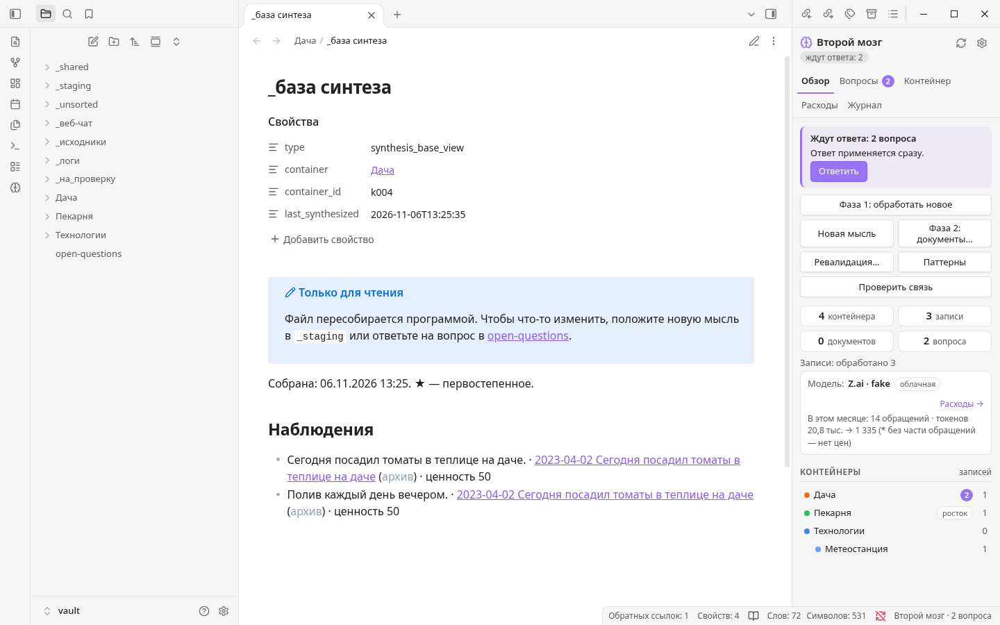
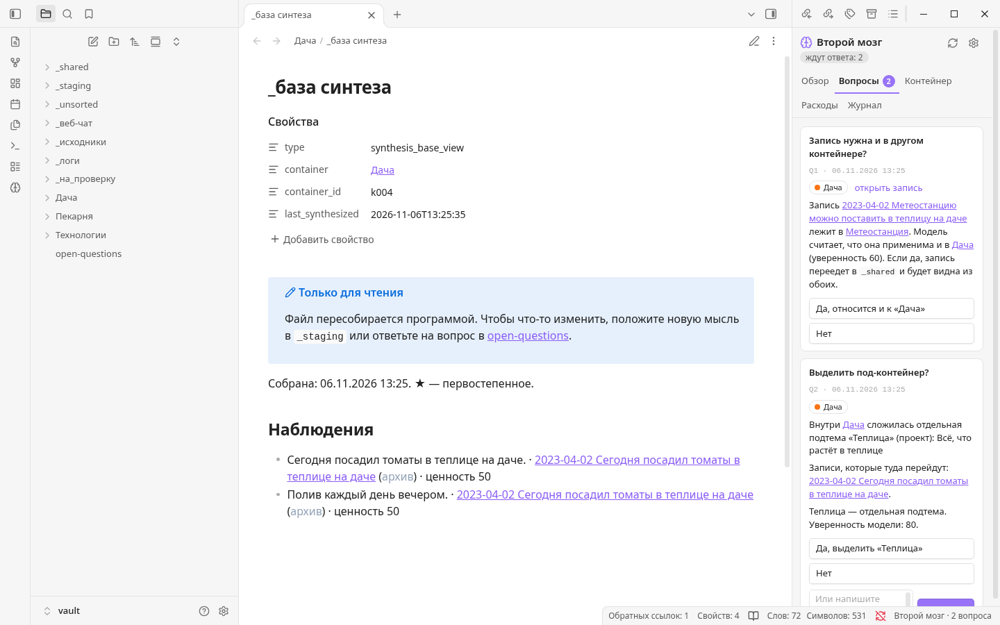

# Второй мозг

**От разрозненных заметок — к целостной картине ваших проектов.**

«Второй мозг» — помощник для Obsidian, который помогает разобраться в мыслях, накопившихся со временем. Загрузите заметки, дневники или диалоги с ИИ: программа поможет распределить их по проектам, увидеть смысловые связи и создать полезные документы, сохранив ваши оригинальные тексты.

[English](README.md) · [Русский](README.ru.md) · [Español](README.es.md) · [Українська](README.uk.md)

---

## Идеям нужно больше, чем просто папка

Мысль редко приходит в нужное место, в готовом виде и в подходящий момент. За месяцы и годы идеи, решения и открытые вопросы оказываются разбросаны по файлам. Найти их снова непросто; ещё сложнее понять, как они связаны между собой.

«Второй мозг» создан для этого беспорядка. Можно сначала записывать, а разбираться со структурой позже. Программа собирает связанный материал вместе, обращает внимание на неопределённости и помогает составить актуальную картину каждого проекта. Важные решения остаются за вами.

## Как это выглядит


*Обзор проекта рядом с базой синтеза.*


*Если решение требует вашего внимания, оно появится во вкладке «Вопросы».*

На скриншотах — демонстрационное хранилище и тестовая модель, а не личные заметки или реальный ИИ-сервис.

## Как это работает

```text
Заметки, дневники и диалоги
              ↓
       _staging / загрузка
              ↓
    Фаза 1 · разбор и структура
              ↓
  Проекты → аспекты → база синтеза
              ↓
     Фаза 2 · создание документов
```

1. **Собирайте.** Положите файлы `.txt` или `.md` в `_staging` либо воспользуйтесь кнопкой «Новая мысль». При первой массовой загрузке проверьте и утвердите предложенную структуру проектов.
2. **Разбирайтесь.** Фаза 1 распределяет записи, извлекает аспекты — например, факты, идеи и планы — и ищет дубли, изменения и противоречия. Для каждого затронутого проекта она собирает базу синтеза.
3. **Решайте.** Модель предлагает варианты и выставляет оценки, а программа применяет настраиваемые пороги. Некоторые неоднозначные или важные случаи превращаются в вопросы к вам. Пока противоречие не разрешено, система может использовать отмеченное предварительное предположение.
4. **Получайте документы.** Запустите Фазу 2 для проекта. Модель использует базу синтеза, чтобы написать обязательный **«Сводный файл»** и, если это полезно, другие документы по материалу. Их можно редактировать: программа учтёт правки при последующих запусках.

## Почему «Второй мозг»?

- **Ваши исходные материалы остаются вашими.** Файлы сохраняются без изменений, а устаревшее и дубли помечаются, а не незаметно исчезают. Предыдущие версии документов сохраняются.
- **Это больше, чем поиск.** База синтеза собирает важные для проекта мысли, включая нерешённые противоречия и альтернативные направления.
- **Человек участвует в решениях.** Можно проверить структуру, ответить на вопросы и настроить пороги, а не поручать модели всё без оговорок.
- **Выбор способа работы с ИИ.** Облачный OpenAI-совместимый API, собственный совместимый сервер или ручной режим через веб-чат. Для разных шагов можно выбрать разные профили.
- **Понятные файлы.** Заметки и документы хранятся в Obsidian как Markdown, рабочие данные — в локальных файлах. Сервер базы данных не нужен.
- **Работа по вашей команде.** Обработка запускается вручную, может продолжиться после прерывания; для облачных моделей доступны оценка расходов и бюджет.

## Быстрый старт

Установщик в комплекте рассчитан на **Windows**. Понадобятся **Obsidian**, интернет для установки и **Python 3.10+**; если Python не найден, установщик может предложить его поставить. Локальная модель эмбеддингов по умолчанию занимает около **6,9 ГБ** и при работе на процессоре требует не менее **16 ГБ ОЗУ**. Видеокарта необязательна; вместо локальной модели можно настроить внешний или облачный сервис эмбеддингов.

1. Создайте или откройте хранилище Obsidian. Выберите **русскую версию** и распакуйте её в отдельную папку программы **вне** хранилища.
2. Запустите `Установка.bat`, выберите хранилище и следуйте подсказкам. Включайте сторонние плагины, только если доверяете их источнику.
3. В **Настройки → Второй мозг → Модели** настройте языковую модель и эмбеддинги, затем нажмите «Проверить связь».
4. Положите несколько файлов `.txt` или `.md` в `_staging`. Запустите Фазу 1, при необходимости проверьте предложенную структуру и ответьте на вопросы.
5. Выберите проект и запустите Фазу 2, чтобы создать документы.

Подробности установки и работы — в `ИНСТРУКЦИЯ.md` внутри русской версии. Начните с тестового хранилища или копии заметок и сохраняйте резервные копии. Не распаковывайте другую языковую версию поверх существующей установки: перенос между версиями не проверен.

## Приватность и выбор модели

По умолчанию эмбеддинги считаются локально; при желании можно настроить внешний сервис. При использовании облачной языковой модели или облачных эмбеддингов соответствующий текст отправляется провайдеру — ознакомьтесь с его условиями и политикой конфиденциальности. Ключи API хранятся рядом с программой, а не в хранилище. Для ручного веб-чата эмбеддинги всё равно нужны: они могут быть локальными или внешними.

Ответы модели могут содержать ошибки. Проверяйте документы, особенно противоречия и важные решения. В английской версии промпты просят модель писать на языке исходных заметок, но результат зависит от самой модели.

## Документация

Python-программа выполняет обработку и обращается к моделям, а плагин Obsidian предоставляет интерфейс. [Техническая спецификация](SPECIFICATION.ru.md) подробно описывает этапы обработки, форматы, промпты и принятые решения. Инструкция внутри каждой версии поможет с установкой и повседневной работой.

---

*Для мыслей, к которым стоит возвращаться.*
