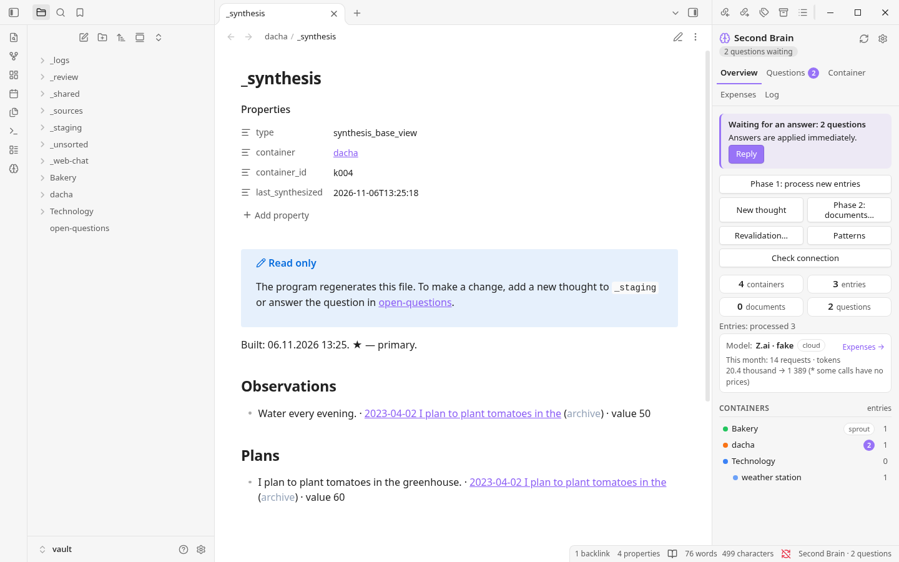
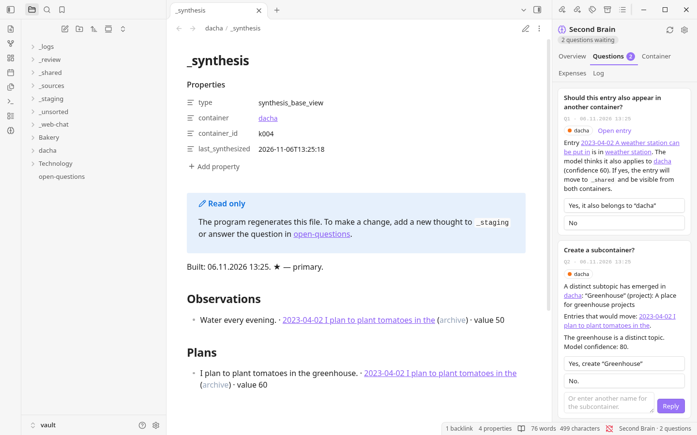

# Second Brain

**Від розрізнених нотаток — до цілісної картини ваших проєктів.**

Second Brain — помічник для Obsidian, який допомагає розібратися з думками, накопиченими з часом. Додайте нотатки, щоденники або діалоги з ШІ: програма допоможе впорядкувати їх за проєктами, знайти смислові зв’язки та створити корисні документи, не замінюючи ваших оригінальних текстів.

[English](README.md) · [Русский](README.ru.md) · [Español](README.es.md) · [Українська](README.uk.md)

---

## Ідеї заслуговують на більше, ніж просто папку

Думка рідко з’являється в потрібному місці, у завершеному вигляді й у потрібний час. За місяці та роки ідеї, рішення й відкриті запитання опиняються в різних файлах. Знайти їх знову непросто; ще складніше зрозуміти, як вони пов’язані між собою.

Second Brain створено саме для такого безладу. Можна спочатку записувати, а впорядковувати пізніше. Програма збирає пов’язані матеріали, звертає увагу на невизначеності й допомагає скласти актуальну картину кожного проєкту. Важливі рішення залишаються за вами.

## Як це виглядає


*Огляд поруч із базою синтезу проєкту. На знімку показано англомовний інтерфейс.*


*Якщо рішення потребує вашої уваги, воно з’явиться у вкладці Questions.*

На знімках — демонстраційне сховище й тестова модель, а не особисті нотатки чи справжній сервіс ШІ.

## Як це працює

```text
Нотатки, щоденники та діалоги
              ↓
       _staging / завантаження
              ↓
  Фаза 1 · впорядкування та аналіз
              ↓
  Проєкти → аспекти → база синтезу
              ↓
    Фаза 2 · створення документів
```

1. **Збирайте.** Додайте файли `.txt` або `.md` до `_staging` чи скористайтеся кнопкою **New thought** на панелі. Під час першого масового імпорту перевірте й затвердьте запропоновану структуру проєктів.
2. **Розбирайтеся.** Фаза 1 розподіляє записи, виділяє аспекти — наприклад, факти, ідеї та плани — і шукає дублікати, зміни та суперечності. Для кожного заторкнутого проєкту вона збирає базу синтезу.
3. **Вирішуйте.** Модель пропонує варіанти й оцінює їх, а програма застосовує настроювані пороги. Деякі неоднозначні або важливі випадки стають запитаннями до вас. Поки суперечність не розв’язана, система може використовувати позначене попереднє припущення.
4. **Отримуйте документи.** Запустіть фазу 2 для проєкту. Модель використає базу синтезу, щоб написати обов’язковий **Summary** та, за потреби, інші документи відповідно до матеріалу. Їх можна редагувати: програма врахує зміни під час наступних запусків.

## Чому Second Brain?

- **Ваші оригінали залишаються вашими.** Вихідні файли зберігаються без змін; застарілий або дубльований матеріал позначається, а не непомітно відкидається. Попередні версії документів зберігаються.
- **Більше, ніж пошук.** База синтезу збирає важливі для проєкту думки, зокрема невирішені суперечності й альтернативні напрями.
- **Людина бере участь у рішеннях.** Можна перевірити структуру, відповісти на запитання й налаштувати пороги, а не доручати моделі всі рішення беззастережно.
- **Ви обираєте, як працювати з ШІ.** Використовуйте хмарний OpenAI-сумісний API, власний сумісний сервер або ручний режим через вебчат. Для різних кроків можна обрати різні профілі.
- **Зрозумілі файли.** Нотатки й документи зберігаються у сховищі Obsidian як Markdown, робочі дані — у локальних файлах. Сервер бази даних не потрібен.
- **Робота за вашим запитом.** Обробка запускається вручну та може продовжитися після переривання. Для хмарних моделей доступні оцінка витрат і налаштування бюджету.

## Швидкий старт

Установник у комплекті призначений для **Windows**. Потрібні **Obsidian**, інтернет для встановлення та **Python 3.10 або новіший**; якщо Python немає, установник може запропонувати його встановити. Типова локальна модель ембедингів займає близько **6,9 ГБ** і потребує щонайменше **16 ГБ оперативної пам’яті для роботи на CPU**. Відеокарта необов’язкова; замість локальної моделі можна налаштувати зовнішній або хмарний сервіс ембедингів.

1. Створіть або відкрийте сховище Obsidian. Оберіть **англійську версію** та розпакуйте її в окрему папку програми **поза** сховищем.
2. Запустіть `Install.bat`, оберіть сховище й дотримуйтеся підказок. Увімкніть сторонні плагіни, лише якщо довіряєте їхньому джерелу.
3. У **Settings → Second Brain → Models** налаштуйте мовну модель і модель ембедингів, а потім натисніть **Check connection**.
4. Покладіть кілька файлів `.txt` або `.md` у `_staging`. Запустіть **Phase 1**, за потреби перевірте запропоновану структуру та дайте відповіді на запитання.
5. Оберіть проєкт і запустіть **Phase 2**, щоб створити документи.

Інструкція зі встановлення та роботи — у файлі `INSTRUCTION.md` всередині англійської версії. Почніть із тестового сховища або копії нотаток і зберігайте резервні копії. Не розпаковуйте іншу мовну версію поверх наявної установки: перенесення між версіями не перевірено.

## Приватність і вибір моделі

Типово ембединги обчислюються локально; за бажанням можна налаштувати зовнішній сервіс. Якщо обрати хмарну мовну модель або хмарні ембединги, відповідний текст надсилається провайдеру — ознайомтеся з його умовами та політикою конфіденційності. Ключі API зберігаються поруч із програмою, а не у сховищі. Для ручного вебчату ембединги все одно потрібні: вони можуть бути локальними або зовнішніми.

Відповіді моделі можуть містити помилки. Перевіряйте створені документи, особливо суперечності й важливі рішення. В англійській версії промпти просять модель дотримуватися мови вихідних нотаток, але результат залежить від самої моделі.

## Документація

Python-програма обробляє матеріал і звертається до моделей, а плагін Obsidian надає інтерфейс. [Технічна специфікація](SPECIFICATION.uk.md) докладно описує етапи обробки, формати, промпти й архітектурні рішення. Інструкція всередині кожної версії допоможе зі встановленням і щоденною роботою.

---

*Для думок, до яких варто повертатися.*
